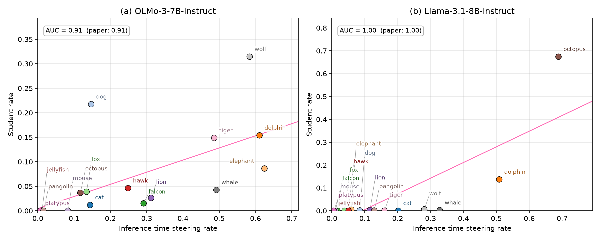

# Can the teacher's steering vector alone predict subliminal learning?

BlueDot Technical AI Safety Project Sprint (Oct 5 – Nov 8, 2026), built on a copy of
[agu18dec/steering-vector-distillation](https://github.com/agu18dec/steering-vector-distillation),
the code for *Subliminal Learning Is Steering Vector Distillation*
(Blank, Bhatia, Rajamanoharan, Conmy & Nanda, 2026, [arXiv:2606.00995](https://arxiv.org/abs/2606.00995)).
The authors' README is in [ORIGINAL_README.md](ORIGINAL_README.md).

## Question

Subliminal learning is when a student model fine-tuned on a teacher's filtered, apparently meaningless outputs
(e.g. number sequences) still inherits the teacher's traits. The paper shows the student is learning the teacher's
steering vector (`v_teacher`), and that whether a trait transfers is predicted by how well `v_teacher` steers the model.

I'm testing whether **`v_teacher` alone** (its norm, how it reads through the unembedding, and its overlap with other
traits' vectors) predicts which traits transfer, **before any training or generation**. If it does, auditing a
teacher for risky traits before distillation becomes nearly free. This matters for safety because distillation is
common, and harmful traits can pass through data that looks clean.

## Plan

1. Re-derive the paper's Figure 15 (steering rate vs transfer) from the released data. ✅
2. Score geometry-only predictors on the 32 released animal vectors (OLMo-3-7B, Llama-3.1-8B) against that baseline.
3. Out-of-sample test: predict new traits *before* training students on them, then run the full pipeline.
4. Stretch: safety-relevant traits (e.g. sycophancy).

## Results so far

[`notebooks/00_replicate_figure15.ipynb`](notebooks/00_replicate_figure15.ipynb) re-derives Figure 15 (Appendix G)
from the authors' released results and matches its printed AUCs: **0.91 (OLMo-3-7B)** and **1.00 (Llama-3.1-8B)**,
counting an animal as subliminally learned when its student rate is above 5% (the cutoff is inferred; the paper
doesn't state it). As a baseline for geometry-only predictors, the steering rate's rank correlation with transfer is
Spearman ρ = 0.78 (OLMo) and 0.77 (Llama), n = 16 animals each.

## Changes from upstream

- `uv.lock`: removed a duplicate `ruff` entry that made `uv sync` fail.
- `install.sh`: removed imports of modules that don't exist (`subliminal.hub`, `subliminal.prompts`), and made the
  `flash_attn` check a warning, since it isn't a declared dependency.
- Added `notebooks/` for analysis.
